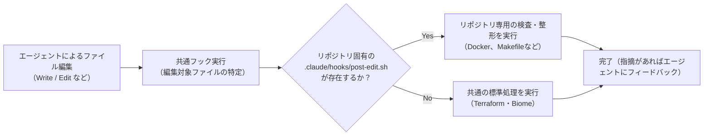

# Agent Plugins

Claude Code と OpenAI Codex で共通して使う、開発用スキル（Skills）とフック（Hooks）を管理するリポジトリです。両ツールが同じ `SKILL.md` とフックのスクリプトを使います。

## 導入方法

各ツールのCLIからユーザー単位でプラグインを登録・インストールします。手動でこのリポジトリをcloneする必要はありません。

| ツール | インストール手順 |
|---|---|
| Claude Code | `claude plugin marketplace add shin4488/agent-plugins --scope user`<br>`claude plugin install agent-plugins@agent-plugins --scope user` |
| Codex | `codex plugin marketplace add shin4488/agent-plugins`<br>`codex plugin add agent-plugins@agent-plugins` |

- インストール後はツールを再起動（リロード）して反映します。
- 動作環境として、ホストマシンに Bash、Git、jq、realpath が必要です。

## 提供スキル一覧

| スキル | 主な役割 |
|---|---|
| `coordinate-sessions` | 作業を、守る条件を保ったまま、親セッションの計画と記録のもとで子セッションに分けて進行 |
| `create-branch` | 基点ブランチを確認し、作業ブランチを作成 |
| `commit` | 変更内容を意味のある単位にまとめてコミット |
| `create-pr` | 変更内容と検証結果をまとめたプルリクエストを作成 |
| `verify-changes` | 変更の動作検証、機密情報の有無、ドキュメントの整合性を確認 |
| `post-merge` | マージ後の反映確認・本番デプロイ・本番確認・リリースとブランチ整理 |
| `release` | リポジトリの規約に沿ったタグ打ち・リリースノート作成 |
| `pin-github-actions` | 外部GitHub Actionsの参照をcommit SHAに固定・検証 |
| `review-dependabot-prs` | 依存関係更新PRの変更内容・CI状態をチェックし、マージ可否を判断 |
| `fix-security-alerts` | GitHubの検出結果・解析警告を切り分け、既存スキルを使って対応PRを作成・解消状態を確認 |
| `spec-based-testing` | 仕様と振る舞いに基づくテストケースの設計 |
| `security-review` | 入力値・権限・通信などのセキュリティ観点でのレビュー・改善 |
| `clear-writing` | 文書・PR本文・コードコメントを、一般的な用語と図・表でわかりやすく書くための決まり |

## 編集後フック（post-edit）

ツールによるファイル編集（Write・Edit・MultiEdit・apply_patch）の後に、編集したファイルのコード整形や静的解析（lint）を実行します。対象は、編集時の作業ディレクトリが属するGitリポジトリ内に存在するファイルです。失敗した編集、削除したファイル、リポジトリ外のファイルは対象にしません。



### 標準処理の対象

| 対象 | 処理 |
|---|---|
| Terraform（`.tf`） | 編集したファイルだけを `terraform fmt` で整形します。そのディレクトリが初期化済み（`.terraform` がある）なら、`terraform validate` も実行します |
| Web関連ファイル（`.ts`、`.tsx`、`.js`、`.jsx`、`.json`、`.css` など） | ファイルと同じか上位のディレクトリ（リポジトリのルートまで）に `biome.json` か `biome.jsonc` があり、`node_modules` にBiomeがインストールされている場合に、`biome check --write` を実行します |

ツールが見つからない場合や、Terraformが未初期化の場合は、スキップした理由を出力します。ツールのインストールや `terraform init` は行いません。

### リポジトリ固有のカスタマイズ

リポジトリ内に `.claude/hooks/post-edit.sh` を配置することで、プロジェクト独自のビルドツール（Docker環境内でのテストや専用Linter）に処理を置き換えることができます。

| 受け渡し | 内容 |
|---|---|
| 作業ディレクトリ | Gitリポジトリのルート |
| 引数 | 編集したファイルの絶対パス。1回の編集で複数のファイルを変えた場合は、まとめて1回で渡します |
| 標準入力 | 編集イベントのJSONは渡しません |
| 結果 | 標準出力・標準エラー出力・終了コードをそのまま返します |

`.claude/hooks/post-edit.sh` がシンボリックリンクでリポジトリ外のファイルを指す場合は、このスクリプトも標準処理も実行しません。

## ディレクトリ構成

```text
agent-plugins/
├── .claude-plugin/       # Claude Code 向けプラグイン定義
├── .codex-plugin/        # Codex 向けプラグイン定義
├── skills/               # 各スキルの定義（SKILL.md）
└── hooks/                # フック設定と共通実行スクリプト
    ├── hooks.json
    └── scripts/
```

## プラグインの更新

```bash
# Claude Code
claude plugin marketplace update agent-plugins
claude plugin update agent-plugins@agent-plugins --scope user

# Codex
codex plugin marketplace upgrade agent-plugins
codex plugin add agent-plugins@agent-plugins
```

## リポジトリのCode scanning

[Shell code scanning](.github/workflows/code-scanning.yml) がmainへのpush、PR、毎週の実行でShellCheckの結果をGitHubのSecurity → Code scanningへ登録します。シェルを実行せずに解析し、エントリーポイントの `post-edit.sh`・`format-lint.sh` と、`post-edit.sh` がsourceする `edited-files.sh` を対象にします。エントリーポイントを追加した場合はworkflowの対象も更新してください。

公開リポジトリの標準Ubuntu runnerだけを使い、Actionsのartifact保存・キャッシュ・大型runnerは使いません。非公開化された場合はジョブを実行しません。ShellCheckはシェルの静的解析であり、Markdownの指示内容やすべての脆弱性を検証するものではありません。
