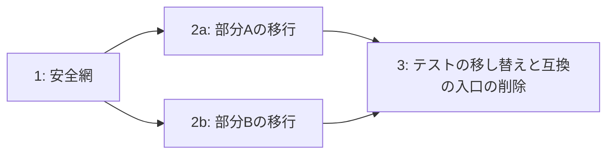

# 計画と進捗の記録

まとめ役が計画を書くときと、進捗を更新するときに使う。1つの文書にまとめる。節の名前と順序は作業に合わせて変えてよいが、表の列は省かない。下の値はすべて例。

## 計画

| 節 | 書くこと |
| --- | --- |
| 今の状態 | 対象の構造・流れ・問題を、図と根拠（ファイル、コマンドの結果、資料）で示す |
| 目標 | 終わったときの状態。今の状態の図と並べる |
| 守る条件 | 変えないもの（外から見える挙動、データの形式、性能の上限など）と、それぞれを確かめる手段 |
| 変わってよいもの | 内部の構造・名前など、変わっても受け入れるもの |
| 判断が要る点 | 案と理由。ユーザーが決めたら判断の記録へ移す |
| 安全網 | 取るコマンドと比べるコマンド、固定した値、比べられない部分を補うテスト、守る決まりを壊して失敗を確かめた結果 |
| 分割 | セッションの一覧と、依存関係・並行できる組の図 |
| 本番への反映 | 反映の順序、反映の前に確かめる状態、ユーザーが実行する操作 |

分割の図の例。2aと2bは依存がないため並行できる。

## 判断の記録

| 日付 | 判断が要った点 | 示した案と理由 | 決定 |
| --- | --- | --- | --- |
| 2026-01-15 | 日付の表示形式の違いを受け入れるか | 案1: 受け入れる（表示だけの違いで、保存する値は同じ）。案2: 直す（画面の利用者に影響しうる） | 案1 |

## 進捗の表と作業記録

状態は「未着手 → 作業中 → PR作成済み → マージ済み → 本番確認済み」の順に進める。本番へ反映しない成果は「マージ済み」で完了とし、本番の列に理由を書く。

| セッション | 成果 | PR | 状態 | CI | 比較 | 本番 |
| --- | --- | --- | --- | --- | --- | --- |
| 1 | 安全網 | PRのURL | マージ済み | 成功 | 2回取得して差なし | 反映不要（テストだけの変更） |
| 2a | 部分Aの移行 | PRのURL | PR作成済み | 成功 | 差なし | 未反映 |

作業記録には、セッションごとに行ったこと・確かめたこと・確かめていないことを書く。

## 全体の状態

セッションが終わるたびに、次の3つをユーザーに示す。

| 項目 | 書くこと |
| --- | --- |
| 完了したもの | 本番確認まで済んだセッション |
| 次に始められるもの | 依存が満たされたセッションと、その指示書を始める1文 |
| 残り | 未着手のセッション、未決の判断、申し送りに残る作業 |
