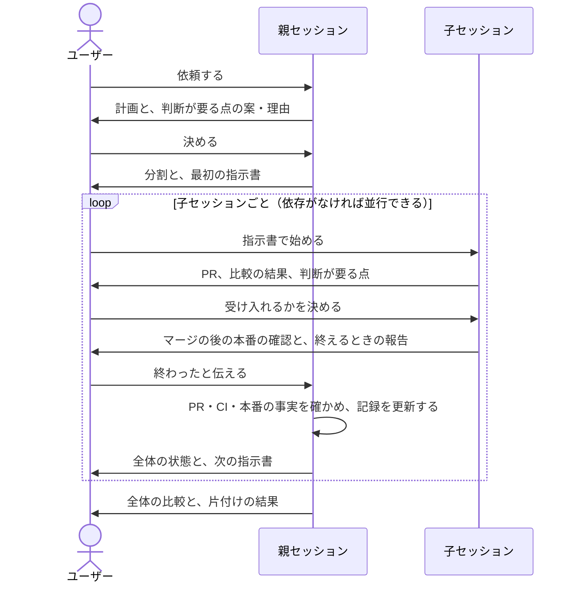

# 作業を複数のセッションに分けて進める

作業を、1つの子セッションで1つの成果（変更ならPR、調査なら結論の文書など）に分けて進める。作業の大きさにかかわらず、ユーザーがこの進め方を選んだときに、全体をまとめる親セッションで使う。守る条件（変えないもの）は、変える前に用意した安全網で確かめる。

計画・指示書・PRの本文・報告は [clear-writing](../clear-writing/SKILL.md) に従って書く。子セッションのブランチ・コミット・検証・PRは [create-branch](../create-branch/SKILL.md)・[commit](../commit/SKILL.md)・[verify-changes](../verify-changes/SKILL.md)・[create-pr](../create-pr/SKILL.md)、マージの後の反映と本番の確認は [post-merge](../post-merge/SKILL.md)、安全網のテストの設計は [spec-based-testing](../spec-based-testing/SKILL.md) に従う。

## 役割

| 役割 | すること |
| --- | --- |
| ユーザー | 親セッションで計画の判断をする。子セッションを始め、子セッションと直接やりとりして、挙動の違いやPRを受け入れるかを決める。子セッションが終わったら親セッションに伝える |
| 親セッション | 計画・分割・指示書・記録・全体の状態を持つ。子セッションの作業と、成果を受け入れるかの判断はしない。サブエージェントは使わない |
| 子セッション | 別のセッションとして始め、サブエージェントでは代えない。指示書に従って1つの成果を作り、判断が要る点はユーザーに直接示す。決定・比較の結果・申し送りをPRに書き、マージの後の反映と本番の確認まで行う |

## 段階ごとの目的と完了の条件

手段は作業に合わせて選ぶ。表の完了の条件を満たし、その証拠を記録に残すまで次の段階へ進まない。

| 段階 | 目的 | 完了の条件と証拠 |
| --- | --- | --- |
| 計画 | 今の状態を根拠つきで調べ、目標・守る条件・変わってよいもの・判断が要る点を分ける | 計画の文書がある。判断が要る点は、すべてユーザーの決定として日付つきで記録されている |
| 安全網 | 守る条件が破られたら、変えた子セッション自身が気づけるようにする | 守る条件ごとに確かめる手段があり、下の「安全網の基準」を満たしている。守る条件のない調査では不要 |
| 分割 | 1つの子セッションで1つの成果に分け、順序と並行できる組を決める | 依存関係と並行できる組の図と、最初の子セッションの指示書がある |
| 進行 | 子セッションが成果を作り、ユーザーが受け入れる | 子セッションが終わるたびに、親セッションが事実を確かめて記録を更新している |
| 仕上げ | 全体で守る条件が保たれたことを確かめ、作業の跡を片付ける | 下の「終える条件」を満たしている |

## 安全網の基準

守る条件を変える子セッションより前の子セッションで作る。

| 基準 | 内容 |
| --- | --- |
| 比べられる | 同じ入力に対して、変更の前と後の出力を比べられる |
| 揺れない | 変更していないコードで2回取り、差がないことを先に確かめる。時刻・識別子・並び順など実行ごとに変わる値は、固定するか比較から外す |
| 手軽に使える | 1つのコマンドで取り、1つのコマンドで比べる。結果は差の件数と最初の差だけを表示し、子セッションの文脈を大きくしない |
| 漏れを補う | 比べても確かめられない部分は、今の挙動をそのまま確かめるテストを先に足す。誤りに見える挙動も直さずにテストし、記録する |
| 効いている | 守る決まりを一時的に壊し、比較やテストが失敗することを確かめてから戻す |

例: 画面やAPIの応答、生成されるファイル、データベースに書き込まれる値を固定した入力で取り出して保存し、変更の後に同じ入力で取り出して比べる。

## 分け方

- 1つの子セッションで1つの成果にする。指示書で読む範囲を絞り、子セッションの文脈が大きくならないようにする。
- 各PRは、単独でマージして本番へ反映できる状態にする。移行の途中は互換の入口を残し、既存のテストを書き換えずに通すことを、挙動が同じことの根拠にする。テストの移し替えと互換の入口の削除は、最後の段階で行う。
- 子セッションの中では、多くのファイルへの同じ形の書き換え、広い調査、PRの前の独立した見直しを、使える環境ではサブエージェントに任せる。
- 依存がない組は並行できる。依存関係と並行できる組は図にする。

## 親セッションの記録

親セッションは次の記録を、子セッションから読める場所に置く。置き場所はリポジトリの規約に従い、なければ計画のときにユーザーと決める。計画を書くときと記録を更新するときは [計画と進捗の記録](references/plan.md) を読む。

| 記録 | 内容 |
| --- | --- |
| 計画 | 今の状態と根拠、目標、守る条件、変わってよいもの、安全網、分割の図 |
| 判断の記録 | 日付、判断が要った点、示した案と理由、ユーザーの決定、決めた場所（親セッション、または子セッションのPR） |
| 進捗の表と作業記録 | 子セッションごとの成果・PR・状態・CI・比較・本番と、行ったこと |
| 申し送り | 次の子セッションが知っておくべき未決の点・見つけた問題・前提の変化 |

記録を更新するのは親セッションだけにする。並行する子セッションが同じ記録を書き換えて競合しないよう、子セッションは決定・比較の結果・申し送りをPRに書き、親セッションがそこから記録へ移す。

## 子セッションを始めて、終わりを記録する

- 子セッションごとに指示書を作り、ユーザーが新しいセッションに貼って始められる1文を渡す。使える環境では、セッションを起動する機能も使う。指示書を作るときは [指示書のひな形](references/session-brief.md) を読む。
- 子セッションが終わったとユーザーから伝えられたら、PRの状態・CI・本番への反映と確認の事実を確かめ、PRに書かれた決定・比較の結果・申し送りとあわせて記録を更新する。事実がPRや報告と食い違えば、記録を更新せずにユーザーに示す。
- 申し送りのうち後続の子セッションにかかわるものは、その指示書に書く。すでに始まっている子セッションにかかわるものは、ユーザーに示し、その子セッションへ伝えてもらう。
- 記録を更新したら、全体の状態（完了したもの・次に始められるもの・残り）をユーザーに示し、次の指示書を作る。

## 並行して進めるとき

- 並行した子セッションのPRは1つずつマージする。後のPRの子セッションは基準のブランチを取り込み、CIと比較を確かめ直してから、ユーザーに受け入れるかを尋ねる。
- すべてマージした後に、並行を始める前と後をまとめて比べる。親セッションで比べるか、そのための子セッションを始める。

## 承認が要る操作と止める条件

| 場面 | 決まり |
| --- | --- |
| 判断が要る点（目標、守る条件と変わってよいもの、分け方、並行する組など） | 親セッションが案と理由を示し、ユーザーが決める。決定を日付つきで判断の記録に残す |
| 挙動の違いが見つかった | 子セッションはその作業を止め、仕様の言葉と具体的な場面（入力と、変更の前と後の結果）でユーザーに示す。受け入れるかが決まるまで、そのPRをマージできると報告しない。決定を日付つきでPRに書く |
| 指示書にない判断が要る | 子セッションはその作業を止め、案と理由をユーザーに示す |
| 誤りに見える今の挙動 | 直さずに記録し、直すかどうかは別の判断としてユーザーに示す |
| 安全網の比較やテストが失敗した、または実行できない | 原因がわかるまで次へ進まない |
| ユーザーの質問 | 質問をきっかけに、頼まれていない変更をしない |
| マージ・本番への反映・公開 | 依頼とリポジトリの規約に従う。このskillはそれらの許可を追加しない |
| 本番への反映の前 | 直近の本番の状態（定期処理の結果など）を確かめる。異常があれば反映せずに報告する |
| 本番のデータを書き換える操作 | ユーザーが実行する。セッションは、そのまま貼って実行できるコマンドと、実行の前後に確かめることを渡す |
| 片付け | 作業用の環境・一時データ・ブランチを、ほかの作業から使われていないことを確かめてから消す。取得に手間のかかるデータは残し、場所と理由を記録する |

子セッションはこのskillを読まずに作業することがあるため、その子セッションにかかわる止める条件は指示書に書く。

## 終える条件

- 進捗の表のすべての子セッションが完了し、PRのマージと本番への反映・確認が済んでいる。反映しないものは理由を記録している。
- 並行の前と後をまとめた比較で、差がないか、ユーザーが受け入れた差だけである。
- 未決の判断と、申し送りに残る作業がない。
- 作業用の環境・一時データ・ブランチを片付け、残したものと理由を記録している。
