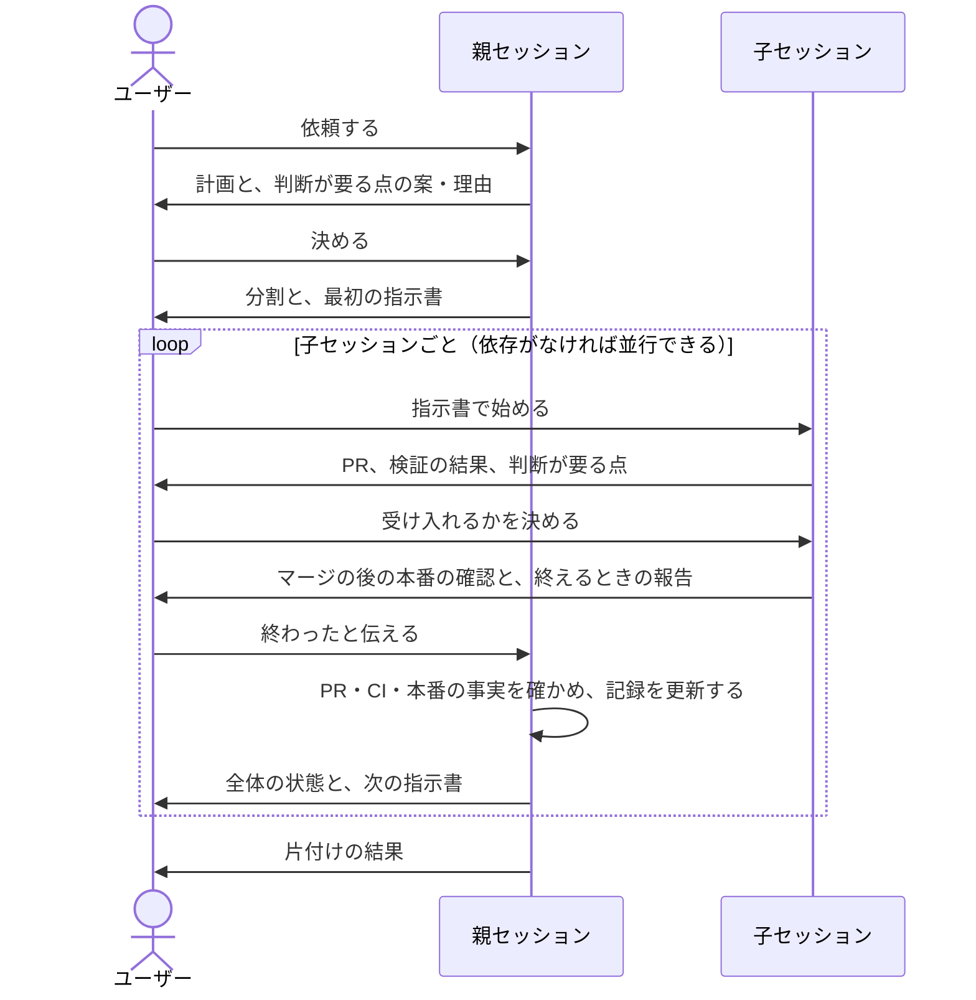

# 作業を複数のセッションに分けて進める

作業を親セッションと子セッションに分けて進める。作業の大きさにかかわらず、ユーザーがこの進め方を選んだときに、全体をまとめる親セッションで使う。変えてはいけない動作（守る条件）は、変更を始める前に検証の方法を用意し、変更のたびにその方法で確かめる。

計画・指示書・PRの本文・報告は [clear-writing](../clear-writing/SKILL.md) に従って書く。子セッションのブランチ・コミット・検証・PRは [create-branch](../create-branch/SKILL.md)・[commit](../commit/SKILL.md)・[verify-changes](../verify-changes/SKILL.md)・[create-pr](../create-pr/SKILL.md)、マージの後の反映と本番の確認は [post-merge](../post-merge/SKILL.md)、検証のためのテストの設計は [spec-based-testing](../spec-based-testing/SKILL.md) に従う。

## 役割

| 役割 | すること |
| --- | --- |
| ユーザー | 親セッションで計画の判断をする。子セッションを始め、子セッションと直接やりとりして、挙動の違いやPRを受け入れるかを決める。子セッションが終わったら親セッションに伝える |
| 親セッション | 計画・分割・指示書・記録・全体の状態を持つ。子セッションの作業と、成果を受け入れるかの判断はしない |
| 子セッション | 指示書に従って成果を作り、判断が要る点はユーザーに直接示す。後続の子セッションに引き継ぐことがあれば指示書で示された場所に書き、マージの後の反映と本番の確認まで行う |

## 段階ごとの目的と完了の条件

手段は作業に合わせて選ぶ。完了の条件を満たすまで次の段階へ進まない。

| 段階 | 目的 | 完了の条件 |
| --- | --- | --- |
| 計画 | 今の状態を根拠つきで調べ、目標・守る条件・変わってよいもの・判断が要る点を分ける | 計画を記録し、判断が要る点がすべてユーザーの決定として記録されている |
| 検証の準備 | 守る条件が破られたら、変更した子セッション自身が気づけるようにする | 守る条件ごとに検証の方法（変更の前後で結果を比べる、テストを足すなど）があり、変更していない状態では同じ結果になり、守る条件を破ると失敗することを確かめている。守る条件にかかわる変更より前に用意する。守る条件のない調査では不要 |
| 分割 | 子セッションの分け方・順序・並行できる組を決める | 依存関係と並行できる組の図と、最初の子セッションの指示書がある |
| 進行 | 子セッションが成果を作り、ユーザーが受け入れる | 子セッションが終わるたびに、親セッションが事実を確かめて記録を更新している |
| 仕上げ | 作業の跡を片付ける | 下の「終える条件」を満たしている |

子セッションは、レビューしてマージできるまとまりで分け、必要以上に細かく分けない。各PRは、単独でマージして本番へ反映できる状態にする。

## 親セッションの記録

親セッションは、次の項目を1つの記録にまとめる。親セッションの文脈が要約されたり、セッションが終わったりしても、記録から再開できるようにするため。置き場所はリポジトリの規約に従い、なければ計画のときにユーザーと決める。

| 項目 | 内容 |
| --- | --- |
| 計画 | 今の状態と根拠、目標、守る条件、変わってよいもの、検証の方法、分割の図 |
| 判断 | 判断が要った点、示した案と理由、ユーザーの決定 |
| 進捗 | 子セッションごとの成果・PR・状態・CI・検証の結果・本番への反映 |

競合を避けるため、記録を更新するのは親セッションだけにする。

## 子セッションを進める

親セッションは子セッションごとに指示書を作り、ユーザーが子セッションを始めるための指示を渡す。指示書はファイルでも、子セッションに貼る文章でもよい。使える環境では、セッションを起動する機能も使う。子セッションは親セッションのやりとりもこのskillも読まずに作業することがあるため、指示書だけで作業を始めて終えられるように、次を書く。

| 項目 | 書くこと |
| --- | --- |
| 目的 | 作る成果と、分割の図の中での位置 |
| 読むもの | 関係するファイル・資料と、読まなくてよい範囲 |
| 引き継ぐこと | 前の子セッションから引き継ぐことのうち、この子セッションにかかわるもの |
| 守ること | 守る条件と変えてはいけない範囲。守る条件にかかわる挙動の違いが見つかったときや、指示書にない判断が要るときは、作業を止めてユーザーに示すこと。親セッションの記録は直さないこと |
| 完了の条件 | 合否の基準。後続の子セッションに引き継ぐことがあれば、それを書く場所 |

- 子セッションが終わったとユーザーから伝えられたら、PRの状態・CI・検証の結果・本番への反映と確認の事実を確かめて記録を更新する。事実がPRや報告と食い違えば、記録を更新せずにユーザーに示す。
- 子セッションは、後続に引き継ぐこと（未決の点・見つかった問題・前提の変化）があれば、計画のときにユーザーと決めた場所に子セッションごとに分けて書く。例えば、同じマシンならリポジトリの外のmdファイル、クラウドなら作業全体で1つのIssueへのコメントにする。親セッションはそれを読み、まだ始まっていない子セッションにかかわるものはその子セッションの指示書に書き、すでに始まっている子セッションにかかわるものはユーザーに示して伝えてもらう。
- 記録を更新したら、全体の状態（完了したもの・次に始められるもの・残り）をユーザーに示し、次の指示書を作る。

## 終える条件

- すべての子セッションの成果がマージされ、本番への反映と確認が済んでいる。反映しないものは理由を記録している。
- ユーザーの判断を待っていることや、後回しにした作業が残っていない。
- 作業のために用意した環境・一時データ・ブランチを、ほかの作業で使っていないことを確かめて片付けている。今後も使う見込みがあり、作り直すのが難しいものは残し、残したものの場所と理由をユーザーに伝えている。
